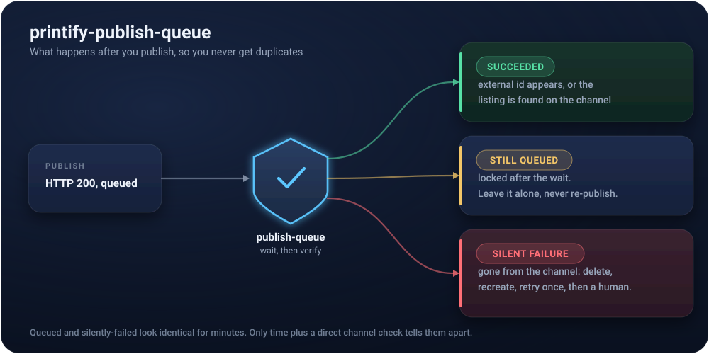

[](https://github.com/Themis-Foundry/printify-publish-queue/actions/workflows/ci.yml)
[](https://www.python.org/downloads/)
[](LICENSE)

# printify-publish-queue

A hardened publish flow for the Printify API, built from a bulk-publish night that hit every failure mode the platform has. If you publish products to Shopify or Etsy through Printify, this is the state machine that stops you from creating duplicates.

## The problem

Printify's publish endpoint returns HTTP 200 immediately. The actual sync to your sales channel happens later, through an internal queue you cannot see. When that queue is slow, the product looks stuck: locked, no external id. The obvious move is to publish again.

The obvious move is wrong. The first publish is still queued. Your retry stacks a second publish behind it, both eventually fire, and now Shopify has two of the same product. On Etsy that same impatience costs $0.20 per duplicate listing, and Etsy's algorithm penalizes duplicate titles besides.

I learned each of these the expensive way, in one night, on a 6-product batch that became 12 products on Shopify.

## State machine

<p align="center">
  
</p>

## The three failure modes

| Mode | Looks like | Actually is | Safe response |
|---|---|---|---|
| A: queued, still pending | stuck (locked, no external id) | normal slow queue | WAIT. Up to 7 minutes. Never re-publish. |
| B: silent failure | identical to A, then unlock with nothing on the channel | the sync died | DELETE the product, re-create fresh, publish the new one |
| C: title collision | duplicate listings, ambiguous recovery | self-inflicted: identical titles in one batch | refuse the batch before any API call |

The cruel part: A and B look identical for the first several minutes. The only safe disambiguation is time plus a direct check of the target channel. Printify's own external-id cache can disagree with reality, so the channel is the source of truth.

## The five rules the machine enforces

1. Wait at least 5 minutes before judging a publish (the constructor rejects anything shorter).
2. Never re-publish a product that is still locked after the wait. Locked means queued.
3. Recover silent failures by DELETE + re-create, never by re-publishing the same product. One recovery attempt, then a human.
4. Serialize bulk publishes with a cooldown between products. Parallel triggers are what cause modes A and B in the first place.
5. Verify against the target channel directly, not Printify's cache.

## Usage

```python
from printify_publish_queue import PublishQueue, Outcome

queue = PublishQueue(
    token=PRINTIFY_TOKEN,
    shop_id="12345678",
    # Rule 5: check the channel directly. You supply this because it is
    # channel-specific (Shopify Admin API, Etsy v3, ...).
    channel_has_listing=lambda title: shopify_has_product_titled(title),
    # Rule 3: re-create from YOUR source data when recovery is needed.
    recreate_product=lambda old_id, title: create_product_from_source(title),
)

results = queue.publish_many([
    ("product-id-1", "Sunset Print Mug (Coral)"),
    ("product-id-2", "Sunset Print Mug (Slate)"),
])

for r in results:
    print(r.title, r.outcome, r.external_id, r.notes)
    # Outcome.STILL_QUEUED means: check this one again later. Do nothing else.
```

The two callbacks are deliberately yours to supply. Checking a channel and re-creating a product are business-specific; the dangerous sequencing logic is not, and that's what this module owns.

## Tests

```bash
python3 -m unittest test_publish_queue -v
```

Nine tests, no network, no real time (the clock is injected). The assertions that matter most are the negative ones: exactly one publish call in the still-queued case, zero API calls before a title-collision refusal, exactly one recovery attempt before giving up.

## Who made this

Kyle Miller. I run an e-commerce operation with more than a thousand live products published through Printify by pipelines, and this module is the publish layer extracted from it. I specify, test and verify; the code is written by AI coding agents under my direction. More: [linkedin.com/in/kylemillerfl](https://www.linkedin.com/in/kylemillerfl)

## License

MIT
